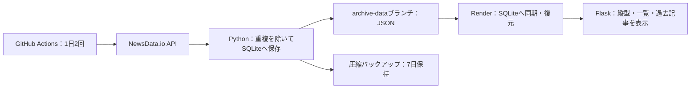

# Global Brief

**国際ニュースを、知るきっかけをつくるWebアプリ。**

画像を中心にした縦型ニュース、地図クイズ、出典付きの背景解説を通して、国際情勢に触れる入口をつくる、学術・非商用の個人開発プロジェクトです。

**[公開サイトを開く](https://global-brief-00i2.onrender.com/)** · [一覧で読む](https://global-brief-00i2.onrender.com/articles) · [背景を知る](https://global-brief-00i2.onrender.com/background)

> Renderの無料環境で公開しています。初回アクセス時に起動を待つ場合があります。ニュースは無料APIの仕様により12時間遅延し、取得漏れもあるため、速報サービスではありません。

## 制作の背景

国際関係学部の講義で、教授から国際情勢について質問された際、私を含め、自信を持って答えられる学生がいませんでした。SNSから多くの情報を得られる一方で、国際情勢のようなニュースには日常的に触れていないという課題を感じたことが、制作のきっかけです。

若い世代が慣れ親しんだ縦スクロールを取り入れ、まずは画像と見出しから興味を持ち、気になった記事の説明を読める構成にしました。

また、面談で「過去の経緯を知らないと、今のニュースも理解しにくく、興味が湧きにくいのではないか」という意見をいただきました。現在は、ニュースを見る入口に加え、その背景を知る機能も改善しています。

## 主な機能

| 機能 | できること |
| --- | --- |
| 縦型ニュース | 1記事ずつ全画面で表示。PCのスクロール・スマホのスワイプで切り替え、見出しを押すと同じカード内で説明を開閉します。 |
| 地図クイズ | 画像がない・読み込めない記事で、見出しから対応国を特定できる場合に出題。「この国はどこ？」「この国の名前は？」の2形式があります。 |
| 保存・共有 | カードを保存し、縦型画面の「保存済み」から見返せます。共有リンクから該当カードを直接開けます。 |
| 一覧で読む | 一覧形式で記事を閲覧。ブックマーク、リアクション、名前任意のコメント、リンク共有、ダークモードに対応します。 |
| 背景を知る | 初期表示の「まず知っておきたい」で出典付きの背景解説、「過去のニュースを探す」で蓄積記事を閲覧。国・テーマで絞り込めます。 |
| 記事の定期蓄積 | 1日2回の取得を予定し、同じ元記事URLの重複を防いで保存。バックアップも作成します。 |

保存した記事は新着20件から外れても、アーカイブに残っていれば縦型カードで開けます。ブックマークは同じブラウザ内の保存で、PC・スマホ間の同期やログイン機能はありません。

## 工夫した点

### 興味を持ってから、説明を読む

縦型画面では画像と見出しを入口にし、説明はタップで展開します。説明を別の囲み枠に重ねず、見出しの下のグラデーション上に表示することで、同じ画面で読み進められるようにしました。従来の一覧形式も残し、読み方を選べます。

### 画像がない記事も、位置を学ぶ機会にする

地図クイズはAIで毎回生成せず、明示された国名と事前定義した国の輪郭・選択肢を組み合わせています。見出し末尾の媒体名を判定から除くなど、誤った国を表示しないためのルールを設けています。

国を特定できない記事には推測した地図を出さず、テーマのイメージを表示します。テーマ図は、現場写真や記事の事実関係を示す図とは区別しています。

### 背景解説と、過去の記事を分ける

背景解説は確認した出典を付けた資料、過去の記事はAPIから取得した報道の記録として分けています。ロシア・ウクライナの経緯、ブラジルの選挙と民主化、中国の貿易制度、日中関係の基本文書を収録しています。

関連記事の「これまで」や「日本との接点」は、対応する出典付きデータがある場合だけ表示します。根拠のない生活への影響や、記事同士の因果関係を自動で補うことはしていません。

### APIが使えないときも体験を残す

閲覧時にNewsData.ioやGeminiを呼び出さず、保存した記事を表示します。定期取得とは処理を分け、取得失敗時にも直前の保存データを保持します。保存元を復元できない初期状態では、同梱した10記事と2件の公式背景資料を使います。

## 使用技術

| 用途 | 技術・サービス |
| --- | --- |
| バックエンド・画面生成 | Python / Flask / Jinja2 |
| フロントエンド | HTML / CSS / JavaScript |
| 地図・クイズの描画 | SVG / Natural Earthの地図データ |
| データ操作・保存 | SQL / SQLite / JSON |
| ニュース取得 | NewsData.io API |
| AI処理 | Gemini API（要約・注目点などの生成処理を実装。現在の公開表示・定期取得では呼び出しません） |
| 定期取得・バックアップ | GitHub Actions |
| 公開 | Render / Gunicorn |
| バージョン管理・検証 | Git / GitHub / Python unittest |

React、TypeScript、Cloudflare Workers、D1は使用していません。

### データの流れ



- **取得**：日本時間9:23・21:23を予定。1回最大2ページ。実行が遅延・スキップされる場合があります。
- **記事の永続保存**：`archive-data`ブランチのJSONを保存元にし、RenderのSQLiteは復元可能な読み込み用キャッシュとして利用します。
- **表示**：トップ・一覧は原則新しい20件、過去記事の画面は最大200件。保存件数そのものを200件で打ち切る仕組みではありません。
- **投稿データ**：コメント・リアクションは別のSQLiteに保存します。現在は試験運用で、再起動・再デプロイ時に失われる可能性があり、記事バックアップには含めません。

## 担当範囲・AI支援

個人開発として、企画、画面設計、ニュース取得・保存処理、機能追加、公開・改善に取り組んでいます。設計案の検討、コードの作成・修正、調査やテストの補助にAI支援を活用しています。

実装の支援にAIを使うことと、アプリが閲覧のたびにAIを呼び出すことは別です。地図クイズ、保存・共有、背景解説の表示、定期取得は、Geminiを使わず動作します。

## 現在の課題・今後の改善

- **背景解説の拡充**：国の歴史や現在のニュースに至る経緯を知る機能は、まだ限られたテーマのみです。記事を蓄積するだけで歴史を説明できるわけではないため、出典を確認した解説と結び付けていく必要があります。
- **情報の欠落と判定精度**：画像・説明文がない記事や、途中で切れた説明文があります。説明は完結した文までにとどめ、続きは元記事へ案内します。国名のルール判定も、すべての記事に対応するものではありません。
- **投稿機能の運用**：コメント・リアクションの永続保存、荒らしへの対応、管理・削除の仕組みを整える必要があります。
- **効果の検証と技術理解**：縦型やクイズがニュースへの関心・理解に役立つか、利用者の反応を通じて検証したいと考えています。AI支援で採用した実装も、自分で説明・修正できる理解を深めることが課題です。

## ローカルで動かす

Python環境で、以下を実行します。

```bash
pip install -r requirements.txt
python -m flask --app app run --host 0.0.0.0 --port 5058
```

ブラウザで `http://127.0.0.1:5058/` を開きます。画面の表示にAPIキーは不要です。公開アーカイブの読み込みや外部画像には通信が必要で、取得できない場合は保存済みデータを使います。

定期取得に使用する `NEWSDATA_API_KEY` は環境変数・GitHub Actions Secretで管理し、リポジトリには含めません。

起動設定、テスト、バックアップの復元方法は **[運用手順](docs/OPERATIONS.md)** にまとめています。

## 主なファイル

| ファイル | 役割 |
| --- | --- |
| [submission.py](submission.py) / [public_feed.py](public_feed.py) | 公開ルート・表示する記事の選択 |
| [article_presentation.py](article_presentation.py) | 説明文の整形・国クイズの判定 |
| [static/vertical_feed.js](static/vertical_feed.js) / [static/story_actions.js](static/story_actions.js) | 縦型切替・保存・共有・保存一覧 |
| [background_guides.py](background_guides.py) / [templates/background.html](templates/background.html) | 背景解説と過去記事の画面 |
| [news_sources.py](news_sources.py) / [news_archive.py](news_archive.py) | API取得・SQLiteへの記事保存と分類 |
| [archive_pipeline.py](archive_pipeline.py) / [archive_store.py](archive_store.py) | 定期処理・バックアップ・同期と復元 |
| [.github/workflows/archive-news.yml](.github/workflows/archive-news.yml) | 取得スケジュールと実行手順 |

## 情報源・利用範囲

学術・非商用プロジェクトとして運用しています。記事・写真の出典と元記事リンクを表示し、API提供の説明文を利用しています。記事本文全体や写真ファイルの再配布は行いません。

地図データの出典は [Natural Earth](static/WORLD_MAP_CREDITS.md) です。背景解説には項目ごとの参照先と確認日を記載しています。プロジェクト終了後は、保存記事・公開環境・バックアップのデータを削除する運用です。
